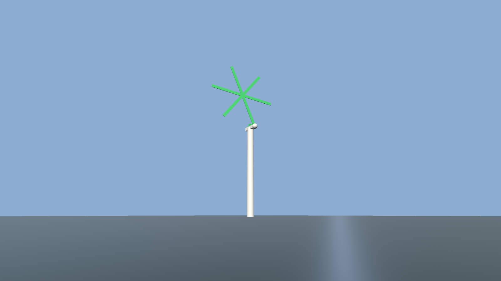
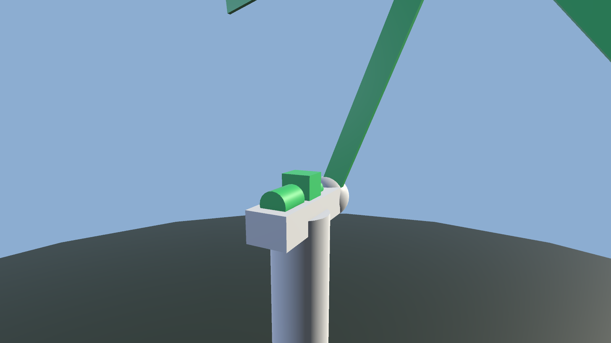
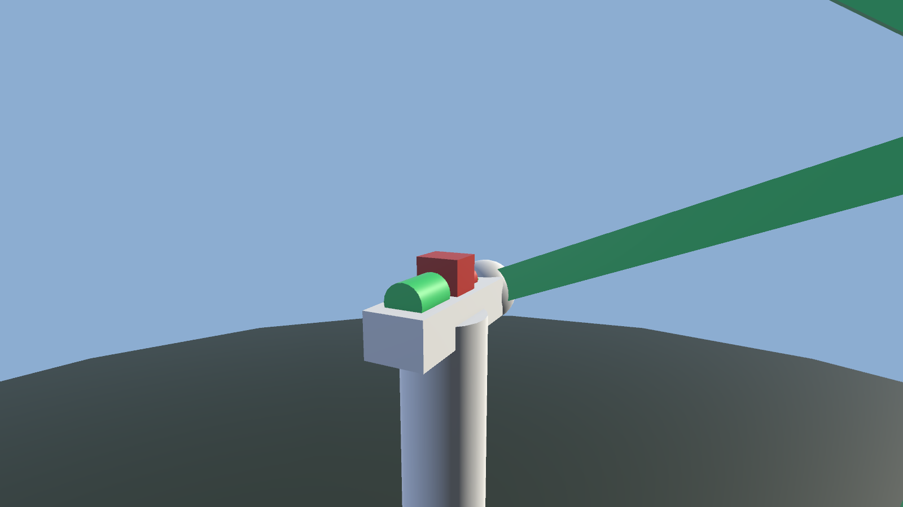

# PoC: telemetry → health → avatar

A minimum viable version of the thesis in one loop, built to answer one question:
**does a telemetry stream, turned into a health score, actually change what the
machine looks like?**

## What it does

1. `tools/telemetry` simulates one 3.6 MW turbine and scores five components
   (blade set, main bearing, gearbox, generator, pitch system) from rule-based,
   explainable health envelopes.
2. The Unity client polls `GET /api/telemetry` once a second.
3. Each frame drives the machine: rotor azimuth, blade pitch, imbalance flapping,
   per-component colour, emission, tremor and an alarm tone.

Health is expressed **perceptually**, not as a number on a chart:

| Channel | Nominal | Degraded | Critical |
| --- | --- | --- | --- |
| Colour | green | amber | red |
| Emission | faint | pulsing | bright, fast pulse |
| Tremor | none | slight | violent, at the measured frequency |
| Alarm | silent | silent | beeping, faster as it worsens |

The default view frames the whole machine — 142 m from tower foot to blade tip:



Flown to the drive train, a healthy machine: every avatar green.



The same view at `t=150 s` of the `gearbox_degradation` scenario. The gearbox
and the main bearing — which shares its heat signature — have gone red. The
generator, the pitch system and the blades are untouched, because the fault is
discriminative: the scoring rules localise it.



## Run it

Two terminals.

```bash
# 1. telemetry service
cd tools/telemetry
uv sync --extra dev
uv run uvicorn telemetry.main:app --port 8000 --reload
```

```bash
# 2. the client
#    Unity 6000.6.5f1: open the project, load Assets/Scenes/Mvp/Mvp.unity, press Play
#    or build the scene from code:
Unity -batchmode -quit -projectPath . -executeMethod Vrar.EditorTools.MvpSceneBuilder.BuildFromCommandLine
```

You start on the ground, ~210 m out, framed on the whole turbine. Controls:
**WASD** to move, **Q/E** down/up, **right-mouse drag** to look, **shift** to
move faster. Fly up to the nacelle to read the avatars. `SimulatedHmdRig`
stands in for the XR Device Simulator: no headset, no XR runtime, same camera
rig the XR path will use. The Editor menu **VRAR → PoC → Frame Camera On
Turbine** re-frames the view if you get lost.

### Without the service

```bash
# replay the three frames exported by the service — no Python process needed
Unity ... -vrar-sample
```

### Jumping to a point in the scenario

```bash
Unity ... -vrar-time 150      # scrub straight to a failing machine
Unity ... -vrar-endpoint http://192.168.1.10:8000
```

Editor menu **VRAR → PoC** exposes scene build and screenshot capture. To
capture a frame headlessly, the way the images above were produced:

```bash
# whole machine (default view)
Unity -batchmode -projectPath . \
  -executeMethod Vrar.EditorTools.PocCapture.CaptureFromCommandLine \
  -vrar-capture-out docs/images/poc-overview.png -vrar-capture-frames 300

# drive train at t=150 s, i.e. the failing gearbox
Unity -batchmode -projectPath . \
  -executeMethod Vrar.EditorTools.PocCapture.CaptureFromCommandLine \
  -vrar-capture-out docs/images/poc-gearbox-fault.png \
  -vrar-capture-view nacelle -vrar-capture-frames 2500 -vrar-time 150
```

## The telemetry contract

`GET /api/telemetry?t=<seconds>` returns one frame. The clock is explicit rather
than wall-clock, so any moment in a fault programme can be requested directly and
replayed identically — which is what makes the tests stable.

```jsonc
{
  "schema_version": 1,
  "tick": 1500,
  "elapsed_s": 150.0,
  "scenario": "gearbox_degradation",
  "healthy_asset": false,
  "environment": { "wind_speed_ms": 10.3, "rotor_rpm": 9.6, "active_power_kw": 1531, "yaw_deg": 186.6, "ambient_temp_c": 7.6 },
  "signals":  [ { "id": "gearbox_vibration_mm_s", "value": 5.9, "unit": "mm/s" }, ... ],
  "components": [
    {
      "id": "gearbox",
      "label": "Gearbox",
      "health": 0.038,
      "state": "critical",
      "trend": 0.002,
      "factors": [ { "signal": "gearbox_temp_rise_c", "value": 18.1, "warn": 6.0, "critical": 15.0, "severity": 1.0, "weight": 0.85, "contribution": 0.62, "unit": "degC" } ]
    }
  ]
}
```

`factors` is the explainability payload: every score can be traced back to the
signals that produced it, with their warning and critical envelopes. The HUD and
the API's `/api/fault` endpoint print the top factor verbatim.

Other endpoints: `/api/scenarios`, `/api/components` (health only),
`/api/fault` (verdict + maintenance recommendation),
`POST /api/scenario/{id}` (switch programme).

### Scenarios

| id | fault |
| --- | --- |
| `nominal` | healthy asset |
| `gearbox_degradation` | gearbox bearing wear: temperature rise and vibration |
| `generator_overheat` | cooling loss, power derate, converter faults |
| `blade_imbalance` | once-per-rev rotor vibration |
| `pitch_fault` | pitch feedback drift |

Each faults one component and leaves the rest healthy — if every component goes
red at once, the scoring has stopped being discriminative, and
`test_gearbox_fault_is_localised_to_the_gearbox` fails.

## Verification

```bash
# service: 31 tests over the simulation, the scoring rules and the HTTP contract
cd tools/telemetry && uv run pytest

# Unity: contract, avatar expression and wiring tests
unity test --mode PlayMode --output /tmp/playmode.xml
```

- `TelemetryContractTests` parses `Assets/StreamingAssets/telemetry_sample.json`,
  a payload the Python service really produced. If the JSON contract drifts, the
  Unity suite fails before anyone opens the Editor. Regenerate it with
  `uv run python -m telemetry.export_sample`.
- `TurbineAvatarTests` asserts the claim itself: a healthy frame leaves every
  avatar green; a faulted frame turns the gearbox red and spares the generator;
  failing parts tremble and healthy ones hold still.
- `SceneRigTests` guards two bugs this PoC actually had: a rig built in the
  Editor lost its avatar index when the scene was loaded from disk and silently
  dropped every frame, and the scene's default camera cropped the rotor out of
  frame. It projects the machine's bounding box through the camera and asserts
  all eight corners land on screen, and that the fly rig keeps the authored view
  angle instead of snapping to the horizon.
- `LiveServiceTests` round-trips against a running service and skips when it is
  not reachable, so the suite still passes offline.

## Honest limits

This proves the **loop**, not the product.

- The data is synthetic. The fault signatures are plausible and reproducible, not
  derived from a real failure record, and nothing here is a claim about
  predictive accuracy.
- The scoring rules are hand-written envelopes with weights. They are
  explainable and discriminative, which is what the demo needs, but they are not a
  trained model and there is no learned baseline to compare against.
- No headset was used. `SimulatedHmdRig` exercises the camera rig and the scene
  on a flat screen; it says nothing about comfort, presence or whether the
  degradation cues read correctly in stereo at scale.
- Audio was verified by construction, not by ear: `ProceduralAudio` synthesises
  the hum and alarm at runtime, and the PlayMode suite runs batched with audio
  disabled.
- The turbine is procedural primitives. There is no imported FBX, no LOD, and no
  claim about performance on standalone VR hardware.