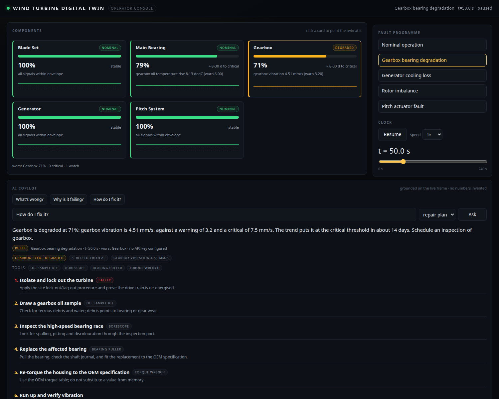

# Operator console

The web page served at `http://127.0.0.1:8000/`. Same process, same clock and
same data as the Unity twin — a second view of one machine, not a second backend.

## Run it

```bash
cd tools/telemetry
uv run uvicorn telemetry.main:app --port 8000 --reload
```

Open <http://127.0.0.1:8000/>. The API docs stay at `/docs`.

## What is on the page

**Left — components.** One card per component with health bar, state chip,
dominant factor, remaining-life band and a 60-sample sparkline. Clicking a card
sets `focus` on the session; the twin flies its camera to the part once (see
[Driving the Unity twin](#driving-the-unity-twin)).

**Right — fault programme.** One button per scenario. Clicking it sends
`POST /api/session { scenario, reset_t: true }`, which restarts the ramp at `t=0`
and both views see the fault develop from the beginning.

**Right — clock.** Play/pause, speed (0.5–10×) and a scrub slider. All three are
`POST /api/session`; the page itself holds no clock state, so a refresh never
loses the moment.

**Below — AI copilot.** Three presets and a free-text box. Answers carry a source
badge (`LLM` or `rules`) and the frame they were grounded on. Switching the mode
to **repair plan** asks for `mode: "procedure"`, which renders the diagnosis
chips, the tool list and the authored steps — safety steps first, with their tool
and rationale. The disclaimer ships with every plan.



## Deep links for demos

`?ask=what`, `?ask=why` and `?ask=fix` open the page and ask that question
immediately after the first frame arrives. `?ask=<anything else>` asks it as a
summary. Useful for a projector: one URL, no clicking.

## Driving the Unity twin

Launch the client in follow mode:

```bash
unity open . --args "-vrar-follow"
# or, equivalently
VRAR_FOLLOW=1 unity open .
```

Unity then requests `/api/telemetry` **without** `?t=` and follows the session
clock. Every control here — scenario, pause, speed, scrub — moves both views.
Clicking a component card sets `focus_seq`; the twin flies its camera **once**
and then leaves the camera alone, so WASD still works.

`-vrar-time` and `-vrar-sample` disable follow mode, because an explicit clock or
an offline replay owns the timeline. The HUD shows `web control` when follow mode
is active.

> **Clock fix:** `-vrar-time 150` now really means 150 s. It previously multiplied
> the request token by ten and jumped to 1500 s.

## What the page does not do

- It does not store anything. No database, no session cookie, no local state
  beyond the sparkline history in memory.

## Design constraints

- **No build step.** One HTML file, one stylesheet, one script. No npm, no
  bundler, no framework — the page has to be runnable from a clean checkout by
  someone who has never seen the repo.
- **No state on the client.** Every control is a command to the service, and
  every second the page re-reads `/api/state`. Refreshing or opening a second
  tab cannot desynchronise anything.
- **No secrets.** The page talks only to our service; the LLM key stays in the
  service environment.
- **Same origin.** Assets are served from `/static`, so there is no CORS
  configuration to get wrong.

## Files

```
src/telemetry/static/
  index.html    layout and panels
  style.css     dark console theme
  app.js        polling, rendering, commands
```

`GET /` serves `index.html`; `/static/*` is a `StaticFiles` mount. The root route
is excluded from the OpenAPI schema so `/docs` stays a pure API reference.

## Verification

```bash
cd tools/telemetry && uv run pytest        # includes test_web.py
```

`test_web.py` asserts the page is served, the assets are reachable, the script
uses `/api/session`, and `/` stays out of the OpenAPI schema.
